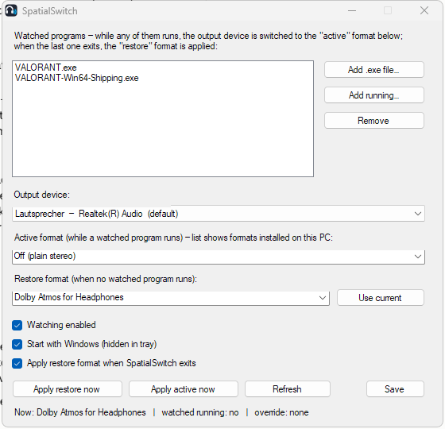

# SpatialSwitch



A tiny Windows tray app that switches **Windows Spatial Sound** automatically: while any program you
select is running, your output device uses one spatial format (for example *Off* for a competitive
shooter with its own HRTF); when the last one exits, it switches back (for example *Dolby Atmos for
Headphones* or *Windows Sonic* for films and YouTube).

Works with any spatial format Windows knows — Dolby Atmos, Windows Sonic, DTS Headphone:X, DTS:X, … or
plain stereo — because it delegates the switch to NirSoft's SoundVolumeView, which accepts format names
and GUIDs alike.

## Why this exists

Windows Spatial Sound is a property of the **output device**, not of the app. There is no per-app
spatial toggle (the per-app volume mixer only offers *output device* and *input device*), so you cannot
have, say, Atmos for your browser and stereo for a game *at the same time* on one pair of headphones.
SpatialSwitch does the next best thing: it flips the device's format on the timeline, edge-triggered, so
each program gets the format you want for as long as it runs.

Typical use: a game that ships its own binaural HRTF (Valorant, CS2, Overwatch 2's in-engine Atmos …)
should not have a second spatializer layered on top — the two smear each other's cues. Watch the game,
set *active format = Off*, and keep your Atmos/Sonic/DTS for everything else without ever touching
Settings again.

## Features

- Watch any number of programs by executable name (pick a file, or pick from running processes)
- Any spatial format for the "active" and the "restore" state, including *Off*
- The format lists show only what is **installed on your PC**: Windows Sonic (built in) plus every spatial
  encoder that Store packages such as Dolby Access or DTS Sound Unbound register (read from their package
  manifests — the same source the Settings app uses). You can still type any name or GUID.
- Every switch is **verified by reading the device back** — SoundVolumeView reports success even for a
  format that isn't installed, so SpatialSwitch checks the result and logs a warning instead of pretending it worked
- First start adopts whatever format your device currently uses as the restore format
- Edge-triggered: only acts on transitions, so manual changes mid-session are respected
- Tray icon with quick actions; window hides to the tray; single instance
- "Start with Windows" (hidden), optional restore-on-exit, log file
- Lightweight: single 25 KB executable on .NET Framework 4.8 (built into Windows), ~8 MB RAM hidden,
  one process-list scan per second (≈0.2 % of one core), no services, no admin rights

## Requirements

- Windows 10/11 with .NET Framework 4.8 (present on every current Windows)
- [SoundVolumeView](https://www.nirsoft.net/utils/sound_volume_view.html) by NirSoft, version 2.48 or
  newer (its `/SetSpatial` command was updated for Windows 11 25H2 in 2.48). It is freeware and is **not**
  included in this repository — run `scripts\get-soundvolumeview.cmd` to download it into `bin\`
  (see `third_party/NOTICE.md`).
- Whatever spatial format you want to switch *to* must already be installed/licensed on the device
  (Dolby Atmos for Headphones requires the Dolby Access app; Windows Sonic is built in).

## Build

No SDK needed — the C# compiler ships with Windows:

```
scripts\build.cmd
```

produces `bin\SpatialSwitch.exe`. Then `scripts\get-soundvolumeview.cmd` puts `SoundVolumeView.exe` next
to it. Run `bin\SpatialSwitch.exe`.

The icon (`src\icon.ico`, 16–256 px) is generated by `scripts\make-icon.ps1` — no graphics tools needed to
change it.

## Configuration

Everything is set in the window: watched programs, output device, active format, restore format,
autostart. Settings are stored in `%APPDATA%\SpatialSwitch\settings.xml`, the log in
`%APPDATA%\SpatialSwitch\spatialswitch.log` (auto-trimmed at 1 MB).

Command line: `SpatialSwitch.exe --tray` starts hidden (this is what the autostart entry uses).
Launching the exe while it is already running just opens the existing instance's window.

## How the switch works

`SoundVolumeView.exe /SetSpatial "<device>" "<format or GUID>"` — an empty format means *Off*.
SpatialSwitch also uses `/scomma` to enumerate render devices and read the current spatial GUID.
Known GUIDs: `{1459AC38-3875-49BF-BB59-0FE80F4D395D}` = Dolby Atmos for Headphones,
`{B53D940C-B846-4831-9F76-D102B9B725A0}` = Windows Sonic for Headphones; unknown GUIDs are passed
through verbatim, which SoundVolumeView accepts.

## Limitations

- One device at a time (pick it in the window; the default render device is preselected).
- Detection latency is up to one second; programs that initialize audio in their very first second
  may need to be watched via their launcher/stub executable instead (e.g. Valorant: watch `VALORANT.exe`
  *and* `VALORANT-Win64-Shipping.exe`).
- Windows itself decides how a plain stereo stream is treated when a spatial format is active on the
  device; SpatialSwitch cannot make two apps use different formats simultaneously.

## License

MIT — see `LICENSE`. SoundVolumeView is © NirSoft, freeware, distributed under its own terms.
